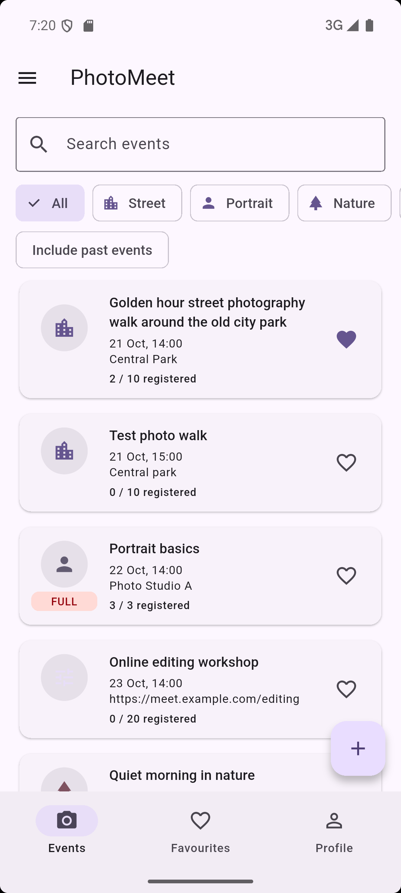
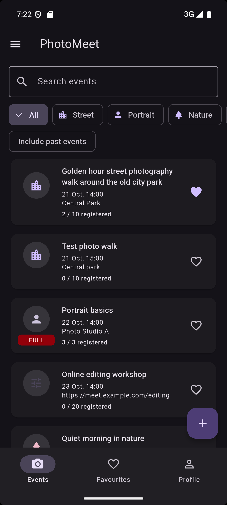
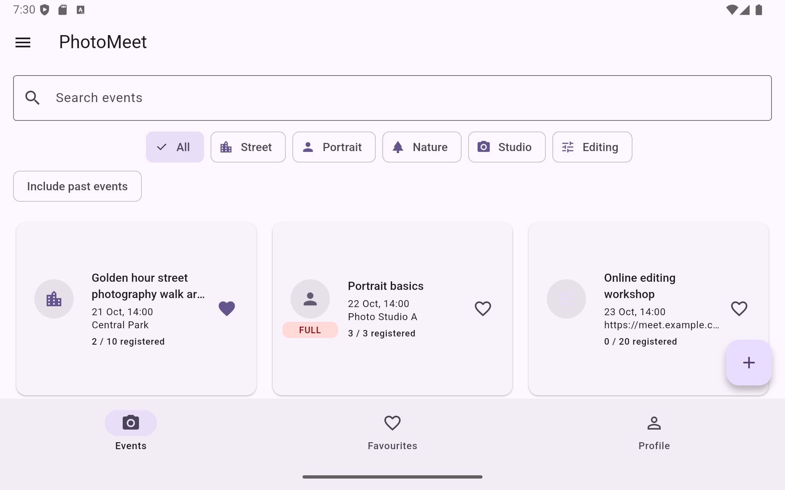

# PhotoMeet

A Flutter application for discovering and joining photography walks
and workshops.

## Domain

An event has a title, category, date and time, place, participant
limit, participant names, online mode, optional description, and
favourite status.

Categories: Street, Portrait, Nature, Studio, and Editing.

## Features

- Three tabs: Events, Favourites, and Profile.
- Search by event title and filter by category.
- Include or hide past events.
- Sort by date, with past events last.
- Create, edit, and delete events.
- Validate form fields before saving.
- Confirm registration and highlight the current participant.
- Show capacity badges and an updating countdown.
- Confirm before discarding unsaved changes.
- Switch between system, light, and dark themes.
- Use a list on phones and a grid on tablets.
- View About and reset data from the drawer.

## Data

All data is stored in memory. Restarting the app restores the seed
events and clears the profile.

The twelve seed events include a 60-character title, a full event,
a past event, an online event, and an event without a description.

## Run

Install Flutter and start an Android emulator or connect a device.

From the photomeet directory:

```bash
flutter pub get
flutter run
```

## Code checks

```bash
dart format .
flutter analyze
```

## Screenshots

### Phone — light theme



### Phone — dark theme



### Tablet — adaptive grid



## Decisions

The event list and profile live in the shell's State so all three
tabs share the same data.
Tabs receive data through constructor parameters and send changes
back through callbacks.
The detail screen uses callbacks to update the shell when an event
is edited, deleted, or joined.
The form returns a PhotoEvent through Navigator.pop, so cancelling
does not change the original event.
ThemeMode lives above MaterialApp so a selection in Profile changes
the appearance of the whole application.
LayoutBuilder uses the available width to choose a list or grid,
with grid cells no wider than 360 logical pixels.
PopScope compares current form values with their initial values to
detect unsaved changes.
With the tools introduced in week 9, I would revisit shared state
management and reduce manual callback propagation where appropriate.